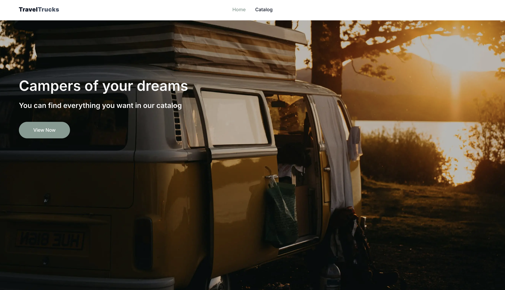
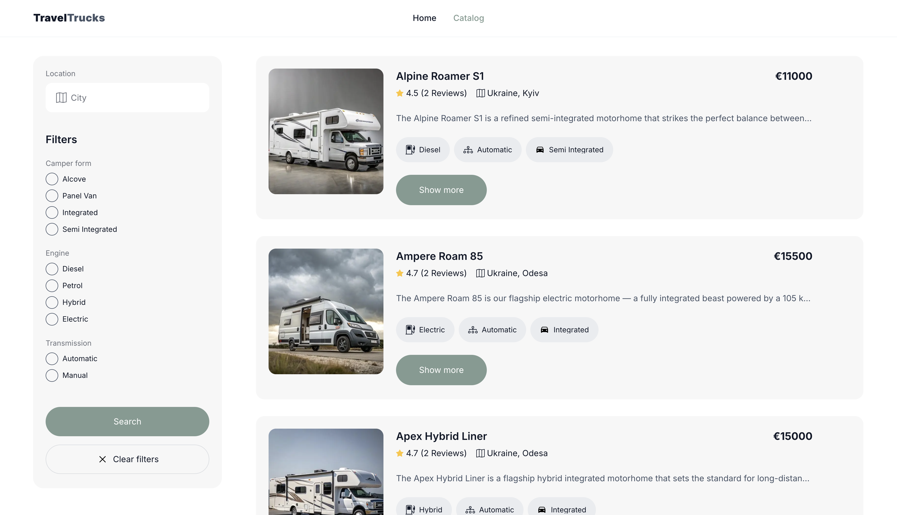

# TravelTrucks

TravelTrucks is a responsive camper rental web application built with Next.js, React, and TypeScript. It allows users to browse campervans, filter listings, explore camper details, read customer reviews, view image galleries, and submit booking requests.

[Live Demo](https://travel-trucks-omega-eight.vercel.app/) · [GitHub Repository](https://github.com/Slava-S943/travel-trucks)

## Preview

### Home Page



### Camper Catalog



## Features

- Responsive layout for different screen sizes
- Home page with a hero section and navigation to the camper catalog
- Camper catalog with filtering by location, camper form, engine, and transmission
- Pagination with a **Load More** button
- Camper details page
- Customer reviews with five-star ratings
- Camper image gallery with Swiper
- Booking form with validation
- Booking requests sent to the backend API
- Success notification after a successful booking
- Loading and error states for asynchronous requests

## Technologies

- **Next.js 16** — React framework and App Router
- **React 19** — UI development
- **TypeScript** — static typing
- **TanStack Query** — asynchronous server-state management
- **CSS Modules** — component-scoped styling
- **React Icons** — icons
- **Swiper** — interactive sliders and galleries

## Getting Started

### Prerequisites

- Node.js
- npm

### Installation

Clone the repository and navigate to the project directory:

```bash
git clone https://github.com/Slava-S943/travel-trucks.git
cd travel-trucks
```

Install dependencies:

```bash
npm install
```

### Development

Start the development server:

```bash
npm run dev
```

Open [http://localhost:3000](http://localhost:3000) in your browser.

### Production Build

Create a production build:

```bash
npm run build
```

Start the production server:

```bash
npm run start
```

### Linting

Run ESLint:

```bash
npm run lint
```

## Project Goals

This project demonstrates frontend development skills, including responsive interface development, API integration, data filtering and pagination, asynchronous state management, and form validation.

## Author

Yaroslav Sobchuk

- [GitHub](https://github.com/Slava-S943)
- [LinkedIn](https://www.linkedin.com/in/yaroslav-sobchuk/)
